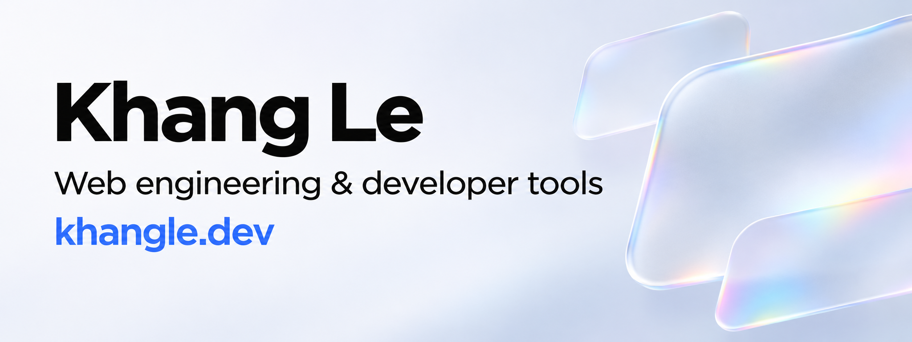

I'm Khang, a frontend engineer based in Vietnam. I've built web products since 2018. Today I work on VietnamWorks, one of Vietnam's largest job sites, and Navigos Talent One, its employer recruitment platform.

Production work I'm proud of:

- Built the frontend for AI job posting on Talent One, now used by about 3 in 4 employers who post a job.
- Designed key parts of Talent One's frontend architecture.
- Built the frontend of a paid hiring-page builder, live for banks and an international talent program.
- Made Talent One's builds 2.4x faster, so updates reach users sooner.
- Built the frontend for AI candidate recommendations and screening on VietnamWorks Employer.

My strengths are frontend architecture for large products, shipping AI features to real users, and fast builds. I can also take a feature end to end, from the screens people use to the server behind them.

I also build AI agent harnesses: the setup that lets AI coding assistants handle real tasks on my team. In a blind test, mine doubled their results on tasks that come with a spec or design.

Outside work I build websites for clients, such as [UWANT Vietnam](https://uwant.com.vn) and [FIX Partner](https://fixpartner.co).

### Tools I build

- [React utilities](https://github.com/khanglvm/react): ready-made building blocks for web apps made with React, a popular way to build web interfaces. They handle shared data, multiple languages and common screen behavior, so new screens take less code. [npm](https://www.npmjs.com/package/@khanglvm/react)
- [Relay](https://github.com/khanglvm/relay): lets you review an AI coding assistant's work visually. You pin comments on the exact part of a page or image, and the assistant gets your feedback where it applies. [npm](https://www.npmjs.com/package/@khanglvm/relay)
- [figma-lens](https://github.com/khanglvm/figma-lens): helps AI coding assistants read designs made in Figma, a popular design tool, so the screens they build match the design. It also checks the finished screens against it. [npm](https://www.npmjs.com/package/figma-lens)
- [Jira CLI](https://github.com/khanglvm/jira-cli): lets people and AI assistants update tasks in Jira, a common project tracker, with short commands. Every change can be previewed before it's sent. [npm](https://www.npmjs.com/package/@khanglvm/jira-cli)
- [Outline CLI](https://github.com/khanglvm/outline-cli): lets people and AI assistants find and edit pages in an Outline team wiki quickly, without overwriting anyone's newer changes. [npm](https://www.npmjs.com/package/@khanglvm/outline-cli)

Most of my work uses TypeScript, React, Next.js, Angular, and Node.js. I care about code that stays easy to change and interfaces that feel right.

[Portfolio & CV](https://khangle.dev) · [LinkedIn](https://www.linkedin.com/in/le-vu-minh-khang/) · [npm packages](https://www.npmjs.com/~levuminhkhang)
